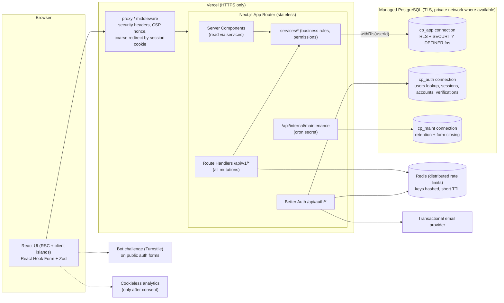
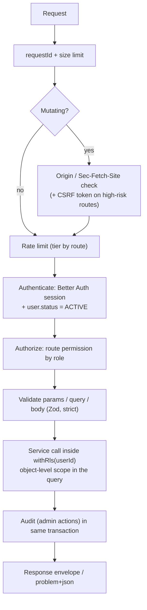
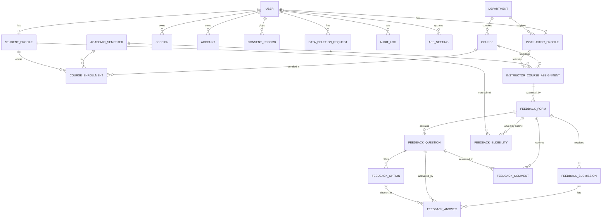
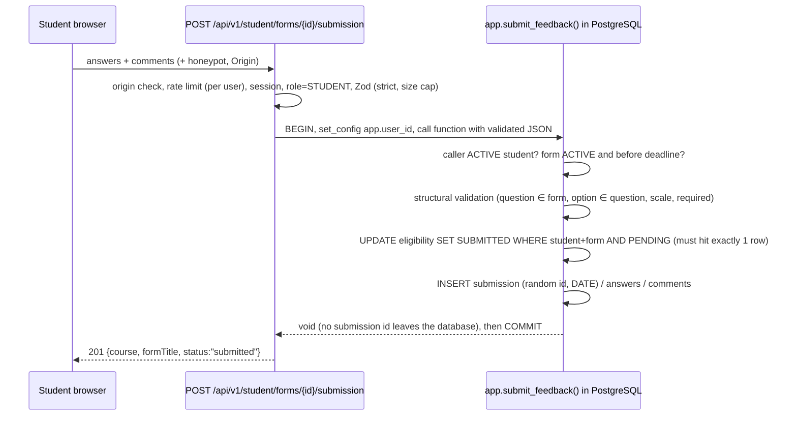

# CoursePulse — Architecture

> **Status: Phase 2 design. No application code exists yet.** Everything below describes the *intended* system. Nothing here has been implemented, executed or tested. Companion documents: [PRD.md](PRD.md), [security.md](security.md), [docs/api-specification.md](docs/api-specification.md), [docs/data-inventory.md](docs/data-inventory.md), [docs/assumptions-and-decisions.md](docs/assumptions-and-decisions.md), [prisma/schema.prisma](prisma/schema.prisma), [prisma/sql/001_rls_and_permissions.draft.sql](prisma/sql/001_rls_and_permissions.draft.sql).

Decision IDs (D-xx) and risk IDs (R-xx) refer to `docs/assumptions-and-decisions.md` and `security.md §15`.

---

## 1. System architecture



Key properties: the app tier is stateless (horizontal scale is free); there are **three distinct database identities** (§6); no file storage exists in v1 (D-12); there is no AI/LLM component (D-14).

## 2. Technology stack (decisions)

| Concern | Choice | Why / trade-off |
|---|---|---|
| Framework | Next.js App Router, React, TypeScript (strict) | Required by brief. Pin exact versions in Phase 3. |
| UI | Tailwind, shadcn/ui, Lucide, Recharts, Framer Motion | Required by brief. Recharts/Framer loaded only on pages that need them (dynamic import). |
| Forms/validation | React Hook Form + Zod | One Zod schema per request shape, shared by client and server. |
| ORM / DB | Prisma + PostgreSQL | Prisma cannot express RLS, partial indexes, CHECKs or functions → a hand-written SQL migration accompanies the schema (R-09). |
| Auth | **Better Auth** (D-01) | Auth.js is now maintained by the Better Auth team and is in security-patch-only mode; its maintainers recommend Better Auth for new projects (checked 31 Oct 2026). The brief allows "another established authentication solution". |
| Password hashing | Argon2id via a native/WASM binding | Better Auth defaults differ; custom hash/verify is configured. Parameters benchmarked on target runtime (start from OWASP minimums). |
| Rate limiting | Redis-backed sliding window (e.g. Upstash) | In-memory limits are useless on serverless. Production boot fails if not configured. |
| Bot protection | Cloudflare Turnstile on login-after-failures, forgot-password, account activation | Not relied on alone; honeypot + rate limits + eligibility checks sit behind it. |
| Email | Provider abstraction (`lib/email`); default Resend (D-17) | No tracking pixels or link rewriting on auth mail. |
| Analytics | Cookieless provider behind consent gate (D-15) | Event allow-list; no identifiers, no feedback text. |
| Hosting | Vercel + managed PostgreSQL (Neon or Supabase-as-Postgres only; D-11) | If Supabase: Data API (PostgREST) disabled for our schemas and `anon`/`authenticated` roles have no grants. |

## 3. Layering and module boundaries

```
 app/ (pages, layouts, route handlers)        ← thin: parse → call service → shape response
   └─► services/<domain>/*.service.ts          ← business rules; the ONLY place that authorizes + calls the DB
         └─► lib/db (withRls, clients)         ← Prisma + $queryRaw (parameterized only)
 components/                                    ← presentation only; may import types + client-safe schemas
 lib/*                                          ← cross-cutting infra (auth, security, http, email, exports, analytics)
```

Import rules (enforced by ESLint `no-restricted-imports` / boundaries plugin, Phase 3):

1. `components/**` and client components never import `lib/db`, `services/**`, `lib/auth/server`, or anything marked `server-only`.
2. Route handlers and pages never import `@prisma/client` directly; they call services.
3. Services never read `Request`/`cookies()`; they receive an explicit `Actor` (`{ userId, role }`) and parsed input.
4. `lib/db` is imported only by services and `lib/auth`.
5. Zod schemas live in `services/<domain>/<domain>.schemas.ts` (client-safe, no server imports) and are shared with forms.

### 3.1 Request pipeline (every `/api/v1` handler)



Server Actions are **not used in v1** (D-10): a single hardened pipeline gives one CSRF surface, one rate-limit layer, one error format and one testable contract. Server Components read through the same services.

## 4. Folder structure

```
src/
  app/
    (public)/            page.tsx, about, features, contact, support, privacy, terms, refund-policy,
                         login, activate (claim account), forgot-password, reset-password
    student/             dashboard, courses, feedback/[formId], history, profile
    instructor/          dashboard, courses, analytics, comparison, reports
    admin/               dashboard, users, courses, departments, semesters, enrollments, assignments,
                         feedback-forms, questions, analytics, reports, comments, deletion-requests,
                         settings, audit-logs
    api/
      auth/[...all]/     Better Auth (allow-listed endpoints only)
      v1/                versioned REST handlers (see docs/api-specification.md)
      internal/maintenance/   cron entry (bearer secret, constant-time compare)
    not-found.tsx, error.tsx, global-error.tsx, robots.ts, sitemap.ts, manifest.ts, icon files
  components/            ui/ (shadcn), layout/, forms/, dashboard/, feedback/, analytics/
  services/              <domain>/ { *.service.ts, *.schemas.ts, *.policies.ts, *.queries.ts }
                         domains: auth, users, catalog (departments/courses/semesters),
                         enrollment, assignments, forms, feedback (submission), analytics,
                         comparison, reports, search, consent, deletion, settings, audit
  lib/
    auth/                Better Auth config, session helpers, Argon2id hasher
    db/                  clients (app/auth/maint), withRls(), error mapping
    http/                route() wrapper, problem+json errors, pagination
    security/            origin-check, csrf, headers/csp, rate-limit, sanitize-text, turnstile
    permissions/         role→permission map, can(), scope helpers
    email/ analytics/ exports/ (csv, xlsx, pdf)
  hooks/ types/ config/  (config/env.ts = Zod-validated environment)
prisma/                  schema.prisma, migrations/, sql/ (raw SQL migrations), seed.ts (dev/demo only)
tests/                   unit/ integration/ e2e/ security/ (security/rls, security/idor, ...)
docs/                    api-specification.md, data-inventory.md, assumptions-and-decisions.md, testing.md
public/                  images/, icons/
```

`services/<domain>/*.policies.ts` hold object-level rules; `lib/permissions` holds role-level rules. Avoid empty modules: a folder is created only when its first real file lands.

## 5. Authentication architecture

* **Account creation is provisioned, not open (D-02).** **Public self-registration is disabled (owner-confirmed).** Admins create or invite students and instructors (single or CSV roster import) and manage activation: send/resend/revoke invitation, suspend/reactivate. The invited person activates the account through an emailed single-use link that proves control of the institutional mailbox and sets their password; an admin can never activate an account or set a password on someone's behalf. There is no sign-up endpoint or page (`disableSignUp`, plus a route-manifest test that fails the build if one appears), and registration is not an admin setting. Rationale: self-registration cannot safely bind an identity to a roster/enrollment, and it removes the most abusable public endpoint. Open registration limited to institutional email domains remains only a documented future option (§12).
* **Sessions:** server-side session records, opaque `HttpOnly; Secure; SameSite=Lax` cookie with `__Host-` prefix. Suggested lifetimes (D-21, confirm): ADMIN 8 h absolute; STUDENT/INSTRUCTOR 7 d sliding.
* **Every request** re-reads `users.status`; `SUSPENDED`/`DELETED` users are rejected immediately even if a session row survives.
* **Password change / reset:** all other sessions are revoked (library option) **and** a belt-and-braces `DELETE FROM sessions WHERE user_id = …` runs in the same operation (tested in Phase 4).
* **Enumeration:** login returns one generic failure; forgot-password and activation-resend always return the same 202 body and similar timing; admin provisioning is the only place existence is revealed (admin-only).
* **Minors:** `ageGroup = MINOR` users stop at `PENDING_GUARDIAN_CONSENT` after email verification until a `GUARDIAN_CONSENT` record exists (guardian email link or admin-recorded institutional consent). The guardian's email is never stored beyond the expiring verification row.
* **Admin bootstrap:** `pnpm admin:bootstrap --email <addr>` (runs as the owner role from an operator machine) creates the first ADMIN and emails an activation link. No default credentials exist anywhere. Admin MFA (TOTP) is recommended for v1 (D-23).

## 6. Authorization architecture — four layers

1. **Route (role) check** — `route({ roles: ['ADMIN'] })` → 401 if unauthenticated, 403 if wrong role.
2. **Object-level scoping in the query, not after it** — services never `findUnique({ id })` a user-addressed resource. They query through scope helpers (`scope.instructorAssignments(actor)`) so an unauthorized ID simply matches no row → **404** (no existence oracle).
3. **Business-rule policies** (`*.policies.ts`): e.g. form must be ACTIVE and within deadline; questions editable only in DRAFT; role change only INSTRUCTOR↔ADMIN.
4. **Database enforcement** — RLS + privilege separation (below). Layers 1–3 are the primary controls; layer 4 catches bugs in them.

### 6.1 Database identities and RLS

| Role | Used by | Can do |
|---|---|---|
| `cp_owner` | migrations, bootstrap CLI (operator only) | owns objects; bypasses RLS; **never** in the runtime environment |
| `cp_app` | request handling | SELECT/INSERT/UPDATE per RLS policy; EXECUTE on `app.*` functions; **no privilege** on sessions/accounts/verifications or on the three anonymous tables |
| `cp_auth` | Better Auth adapter | users lookup, `email_verified`/`status` activation transitions (trigger-guarded), sessions/accounts/verifications |
| `cp_maint` | cron route | EXECUTE `app.close_expired_forms()`, `app.purge_expired()` only |

`withRls(actor, fn)` opens an interactive transaction, runs `SELECT set_config('app.user_id', $1, true)` (transaction-local, so it is safe with transaction-mode poolers) and executes `fn(tx)`. The **role is never passed**: `app.role()` derives it from `users` and requires `ACTIVE`. Privilege-escalating mutations (create user, change role/status, revoke sessions, complete deletion, sync eligibility, moderate comment) exist **only** as `SECURITY DEFINER` functions that re-check the caller and write the audit row in the same transaction. Full policy matrix: `security.md §9`; SQL: `prisma/sql/001_rls_and_permissions.draft.sql`.

## 7. Database relationships



Note what is **absent**: there is no edge between `STUDENT_PROFILE`/`FEEDBACK_ELIGIBILITY` and `FEEDBACK_SUBMISSION`/`FEEDBACK_ANSWER`/`FEEDBACK_COMMENT`, and no edge from `FEEDBACK_COMMENT` to `FEEDBACK_SUBMISSION`. That absence *is* the privacy design.

### 7.1 Deletion rules

| Relationship | Rule | Reason |
|---|---|---|
| User → StudentProfile / InstructorProfile / Session / Account | Cascade | Auth/profile data dies with the user row (user rows themselves are never hard-deleted in production; D-22) |
| StudentProfile → CourseEnrollment, FeedbackEligibility | Cascade | Deleting a student's identity removes their enrollments and participation mapping |
| Department → Course / InstructorProfile | Restrict | Deactivate (`isActive=false`) instead of deleting |
| Course, Semester, InstructorProfile → Assignment / Enrollment | Restrict | History must stay consistent |
| Assignment → FeedbackForm | Restrict | Forms/results outlive assignment edits |
| FeedbackForm → FeedbackQuestion → FeedbackOption | Cascade | Only reachable for forms with no submissions (see next row) |
| FeedbackForm/Question/Option → Submission/Answer/Comment | Restrict | A form with responses can only be archived, never deleted |
| FeedbackForm → FeedbackEligibility | Cascade | Eligibility is meaningless without its form |
| FeedbackSubmission → FeedbackAnswer | Cascade | Retention purge removes a submission and its answers together |
| User → AuditLog / AppSetting actor | SetNull | Audit survives; actor reference is nulled if ever removed |
| User → ConsentRecord / DataDeletionRequest | Restrict | Evidence is retained against the tombstone; users are anonymized, not deleted |

### 7.2 Index strategy (all justified by a query in the API spec)

Unique: `users.email`, `student_profiles.student_number`, `(student_id, form_id)` on eligibility, `(student_id, course_id, semester_id)` on enrollment, `(instructor_id, course_id, semester_id, section)` on assignment, `(academic_year, term_number)`, partial unique indexes (one ACTIVE form per assignment, one current semester, one open deletion request per user, answer uniqueness). Lookup: `(course_id, semester_id, section)` on enrollment and assignment (eligibility sync and student course cards), `(form_id, status)` on eligibility (participation counts), `(form_id, submitted_on)` on submissions (timelines), `(question_id, option_id)` on answers (distributions), `(status, closes_at)` on forms (closing job, pending lists), `created_at` and `(actor_id, created_at)` on audit logs, trigram GIN on `courses(code||title)` and `users(name)` for search.

## 8. Anonymous feedback architecture

### 8.1 Principle: logical separation, **not** cryptographic anonymity

The system stores *who is allowed to answer and whether they did* (identity side) separately from *what was answered* (anonymous side), and ensures no stored value can join the two. This protects against application-level adversaries (instructors, administrators using the UI, API abusers, a bug leaking rows). It does **not** protect against an adversary with raw database/WAL/log access who can correlate commit order or infrastructure logs (R-01). We do not claim otherwise anywhere in the product copy.

### 8.2 What is stored where

| Table | Contains | Deliberately omitted |
|---|---|---|
| `feedback_eligibility` | student ↔ form, `PENDING`/`SUBMITTED`, creation time | completion time, `updatedAt`, any submission reference |
| `feedback_submissions` | random UUID, form, **date** (no time) | user, `createdAt`, sequence numbers, IP, user agent |
| `feedback_answers` | submission, question, one value | user, timestamps |
| `feedback_comments` | form, question, text, moderation status | user, **submission link**, timestamps |

Comments are intentionally not linked to the submission so a comment cannot be joined to the same respondent's rating pattern. Trade-off: no per-respondent export of "rating + comment", and a student cannot retract or edit a submission (D-08).

### 8.3 Submission flow (duplicate prevention without a link)



* **Duplicates / double-click / two tabs / replay:** the conditional `UPDATE` is atomic; a concurrent second call blocks on the row lock, re-checks `status = 'PENDING'`, matches zero rows and fails with `409`. The inserts are in the same transaction, so a failure rolls the flip back.
* **No logging linkage:** this route's logs contain `requestId`, route, status and duration only — **no user id, no body**. Server statement logging and `pg_stat_statements` parameter capture are disabled for the runtime role (R-01 mitigation).
* **Return value:** the function returns `void`; the API response contains course/form display data for the thank-you page and nothing that identifies a row.
* **Why a database function and not app code:** the invariants (one submission per eligibility, structural validity, no direct table access) hold even if an API handler has a bug, and `cp_app` has no privilege to read or write the anonymous tables directly. Cost: logic in PL/pgSQL needs its own test suite and migration discipline; semantic validation stays in Zod.

### 8.4 Release rules (what instructors and admins can see)

1. **Content is released only after the form is CLOSED** (D-06). While ACTIVE, everyone — admins and instructors included — sees *participation counts only*, never ratings or comments. This prevents watching an average move as individual responses arrive (differencing) and protects early submitters.
2. **Minimum-response threshold** `k = min_responses` (default 5, floor 3, institution-configurable) enforced in SQL (`question_stats`, `form_comments`, `analytics_aggregate`) at the **cell** level (distinct submissions contributing to the returned number), not only per form. Suppressed cells return "insufficient responses" and never the hidden count.
3. **No arbitrary date slicing of content for instructors.** Instructors can filter content by academic year / semester / course; date-range filters apply to counts/timelines only. Admin date-range content filters pass the same cell-level threshold and are audit-logged. Reason: overlapping date windows allow subtraction attacks on small cells (R-04).
4. **Comments** appear only after closure and threshold, in pseudo-random order, without any date, grouped by question, and admins can hide abusive or self-identifying comments (audited). Participation counts shown to instructors are refreshed at coarse (hourly) granularity.
5. **Students** see only their own pending/submitted *status* — never their own answers (they are not linkable; D-08).
6. **Participation roster is not visible to anyone.** Admins see counts, not "who has not responded" (D-07); reminders, if added, are sent by an automated job.

### 8.5 Retention of the identity side

At close, `feedback_forms.eligible_count` is snapshotted; eligibility rows are purged `retain_eligibility_days` (default 180) after the deadline. After that, no table anywhere records which students took part in which form, while participation rates remain computable. Answers/comments are purged after `retain_feedback_days` (default 5 years, to be confirmed).

## 9. Analytics, comparison and reporting design

* **Source of truth:** SQL aggregates over real rows via `app.question_stats` / `app.analytics_aggregate` (parameterized; filters validated by Zod: academic year, semester, course, department, instructor, date range, category). No hard-coded numbers; empty/suppressed states are first-class UI states.
* **Normalization (D-19):** rating questions are comparable only with equal `comparisonKey`; scales of different width are normalized to 0–100 for category/overall comparison and the UI shows the raw scale and the response count `n` for every figure. Course comparison discloses unequal `n` and excludes non-comparable questions (listed to the user).
* **Positive/neutral/negative** (D-14): rating bucket rule per scale (top two / middle / bottom two on a 5-point scale; proportional otherwise). **Themes/insights** are deterministic term-frequency over visible comments with a stop-word list, shown only when thresholds are met. No LLM is used; if one is ever added, `security.md §12` applies.
* **Reports:** `POST /api/v1/reports` streams CSV / XLSX / PDF generated on demand, never stored (D-12). Authorization re-checked per request; same release/threshold rules as the UI; CSV/XLSX cells that begin with `= + - @` are neutralized; every export is audit-logged (actor, scope, format; no content).
* **Search:** `GET /api/v1/search` queries only catalogue objects the actor may see (courses, departments, instructors, forms, reports metadata) via RLS-scoped queries with trigram indexes. It never searches comments, never logs the query text, and is rate-limited.
* **Caching:** closed-form aggregates are immutable and may be cached by `(scope, filters)` key; the scope (role + userId or assignment set) is part of every cache key, and nothing user-specific is cached at a shared layer. Future optimization: precomputed per-form stats written at close.

## 10. Operational architecture

* **Environments:** local (docker Postgres, seeded demo data flagged `demo`), preview (ephemeral DB branch, no real data), production. Separate secrets per environment; `config/env.ts` fails the boot on missing/invalid variables and refuses `NEXT_PUBLIC_*` names that look like secrets.
* **Migrations:** Prisma Migrate for schema + a reviewed raw-SQL migration for RLS/functions/constraints; applied by CI with `cp_owner` over a direct connection; runtime roles are created separately and never own objects.
* **Scheduled jobs:** Vercel Cron → `/api/internal/maintenance` (bearer secret, constant-time comparison, `cp_maint` connection): close expired forms, purge expired sessions/verifications/eligibility/audit/feedback per retention.
* **Logging/monitoring:** structured JSON logs with `requestId`, route, status, duration, role (not user id on the submission route), no bodies, no secrets; error tracking with PII scrubbing; DB backups with tested restore (restoring a backup restores identity + feedback together — retention applies to backups too; documented in R-06).
* **Time:** all timestamps `timestamptz` UTC; `submitted_on` computed in `institution_timezone` (a required setting; no default assumed).

## 11. Scalability

Stateless app tier; pooled connections (transaction pooler for `cp_app`, direct for migrations); read-heavy analytics served from closed-form aggregates (cacheable, immutable); indexes above cover hot paths; large installations can add a read replica for analytics, partition `feedback_answers` by form/year, and move exports to an async job queue. Row-level locks in `submit_feedback` are per eligibility row, so submission throughput scales with the number of distinct students.

## 12. Future considerations (not in v1)

Open self-registration with domain allow-list; SSO/SAML via Better Auth plugins; blind-signature/anonymous-credential submission for stronger anonymity (removes the DBA-correlation risk, adds substantial complexity); automated reminder emails; precomputed stats tables; file storage for logos/attachments (would require private buckets and signed URLs per `security.md §13`).
